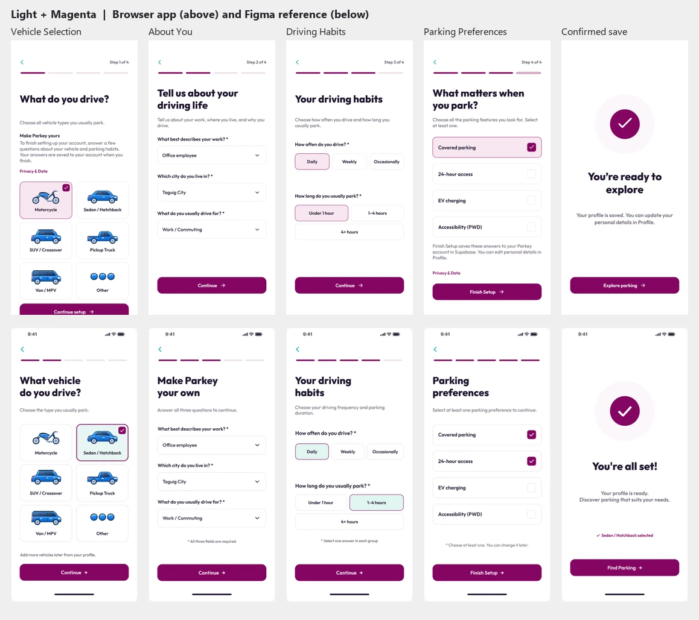
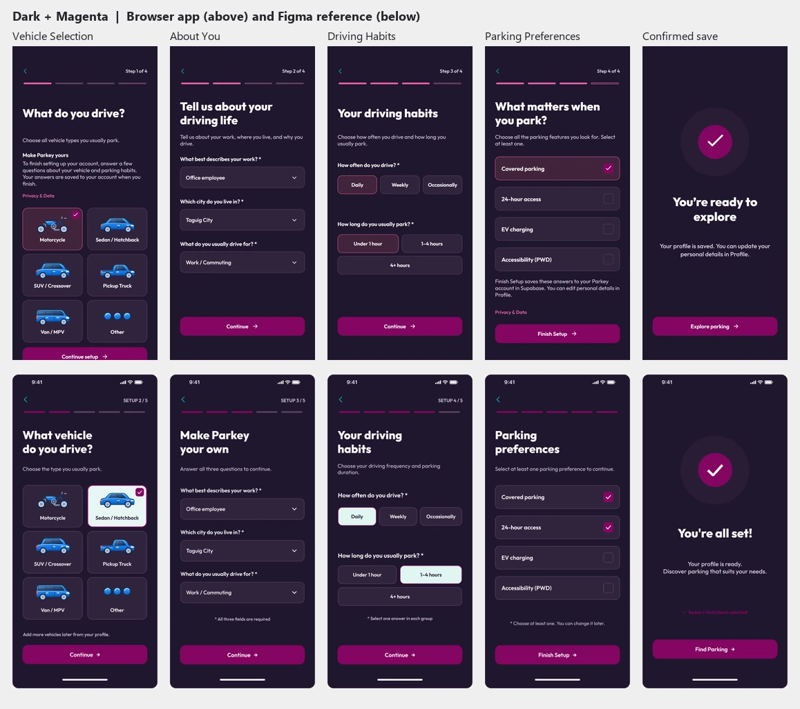
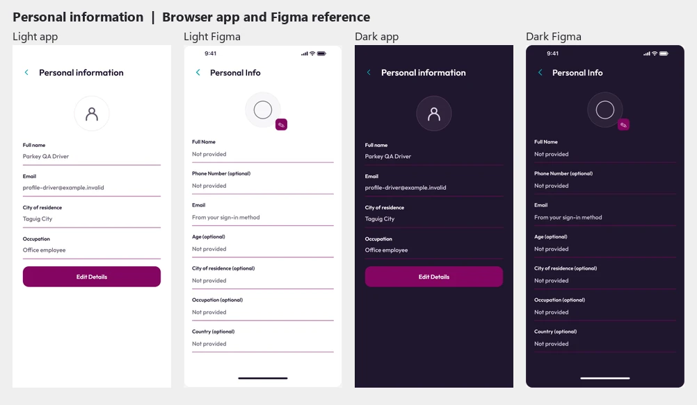
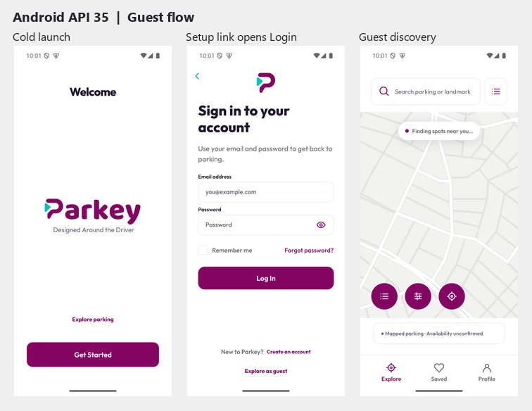

# Mandatory profile survey

Each survey image compares the Parkey browser flow in the top row with the approved Figma screens in the bottom row. The columns show Vehicle Selection, About You, Driving Habits, Parking Preferences, and the confirmation after a successful save. The viewport is 430 × 932. The browser used synthetic account data and an intercepted Supabase Auth service.

The app retains the paired canvas colors, Outfit typography, vehicle artwork, choice cards, and primary action hierarchy. The four-step counter, disclosure, revised copy, and magenta selection states reflect the profile setup brief. The browser view has no native system bars, and the vehicle page scrolls when the disclosure and controls exceed the viewport.

## Light + Magenta

## Dark + Magenta

## Personal information

Personal Info keeps the current Parkey fields and editor and removes legacy age. Phone number and country are outside the active profile contract. The visible account is a test fixture.

The survey uses paired Figma frames 9–13. Personal Info uses frame 77. [Parkey Initial Design](https://www.figma.com/design/UaU1KMJV2tMlwGB7Y1Co1g/Parkey-Initial-Design?node-id=249-2053)

## Android emulator

A separately installed x86_64 build opened Welcome on Android API 35, sent a signed-out setup deep link to Login, and entered discovery through Explore as guest. The signed-in and save paths were tested against the browser fixture. Production Auth and native screen reader behavior were outside this run.

